<!-- Generated by github.com/trick77/ship/kit/schemadoc, do not edit. Regenerate in the Go module directory: SCHEMADOC_UPDATE=1 go test ./... -run TestSchemaDoc -->

# Database schema

26 tables; the diagram is at the end. Go types are the `model.go` structs whose rows they hold.

## artifacts

Go types:

- `artifact.Artifact` (internal/artifact): Artifact represents a file uploaded or generated in the context of a chat thread or project.

| Column | Type | Null | Default | PK |
| --- | --- | --- | --- | --- |
| `id` | TEXT | yes |  | 1 |
| `user_id` | TEXT | no |  |  |
| `thread_id` | TEXT | yes |  |  |
| `project_id` | TEXT | yes |  |  |
| `display_filename` | TEXT | no |  |  |
| `volume_relpath` | TEXT | no |  |  |
| `mime_type` | TEXT | no |  |  |
| `size_bytes` | INTEGER | no |  |  |
| `source` | TEXT | no | `'assistant_generated'` |  |
| `created_at` | TEXT | no | `datetime('now')` |  |
| `deleted_at` | TEXT | yes |  |  |
| `thumbnail_relpath` | TEXT | yes |  |  |

Foreign keys:

- `user_id`, `project_id` → `projects` (`user_id`, `id`), on delete CASCADE
- `user_id`, `thread_id` → `threads` (`user_id`, `id`), on delete CASCADE
- `user_id` → `users` (`id`), on delete CASCADE

Indexes:

- `idx_artifacts_thread` (`user_id`, `thread_id`, `created_at DESC`)
- `idx_artifacts_user_created` (`user_id`, `created_at DESC`)
- `idx_artifacts_user_project` (`user_id`, `project_id`, `created_at`)
- `sqlite_autoindex_artifacts_2` (`user_id`, `id`) unique

Checks:

- `CHECK (size_bytes >= 0)`

## chunks

Go types:

- `rag.MissingVector` (internal/rag): MissingVector is a stored chunk without an embedding.
- `rag.RetrievedChunk` (internal/rag): RetrievedChunk is a chunk returned from a similarity search, with its source document and the KNN distance (smaller = closer).

| Column | Type | Null | Default | PK |
| --- | --- | --- | --- | --- |
| `id` | INTEGER | no |  | 1 |
| `document_id` | TEXT | no |  |  |
| `user_id` | TEXT | no |  |  |
| `project_id` | TEXT | yes |  |  |
| `ordinal` | INTEGER | no |  |  |
| `text` | TEXT | no |  |  |
| `token_count` | INTEGER | no | `0` |  |

Foreign keys:

- `user_id`, `document_id` → `documents` (`user_id`, `id`), on delete CASCADE

Indexes:

- `idx_chunks_document` (`document_id`, `ordinal`)
- `idx_chunks_user_document` (`user_id`, `document_id`, `ordinal`)

## documents

Go types:

- `rag.Document` (internal/rag): Document is an uploaded file tracked for RAG. ProjectID/ThreadID/ArtifactID are nil when absent. A nil ProjectID means user-global scope, unless ThreadID is set (thread-private: retrievable only within that one thread).

| Column | Type | Null | Default | PK |
| --- | --- | --- | --- | --- |
| `id` | TEXT | yes |  | 1 |
| `user_id` | TEXT | no |  |  |
| `project_id` | TEXT | yes |  |  |
| `artifact_id` | TEXT | yes |  |  |
| `volume_relpath` | TEXT | no |  |  |
| `filename` | TEXT | no |  |  |
| `mime` | TEXT | no |  |  |
| `size_bytes` | INTEGER | no |  |  |
| `status` | TEXT | no | `'pending'` |  |
| `error` | TEXT | no | `''` |  |
| `created_at` | TEXT | no | `datetime('now')` |  |
| `embedded_at` | TEXT | yes |  |  |
| `thread_id` | TEXT | yes |  |  |
| `full_text` | TEXT | no | `''` |  |

Foreign keys:

- `user_id`, `project_id` → `projects` (`user_id`, `id`), on delete CASCADE
- `artifact_id` → `artifacts` (`id`), on delete SET NULL
- `user_id` → `users` (`id`), on delete CASCADE

Indexes:

- `idx_documents_artifact` (`artifact_id`)
- `idx_documents_status` (`status`)
- `idx_documents_user_artifact` (`user_id`, `artifact_id`)
- `idx_documents_user_created` (`user_id`, `created_at DESC`)
- `idx_documents_user_project` (`user_id`, `project_id`)
- `idx_documents_user_thread` (`user_id`, `thread_id`)
- `sqlite_autoindex_documents_2` (`user_id`, `id`) unique

Checks:

- `CHECK (size_bytes >= 0)`
- `CHECK (status IN ('pending','extracting','embedding','embedded','stale','error'))`

## message_fts

Virtual table: `fts5(message_id UNINDEXED, thread_id UNINDEXED, user_id UNINDEXED, content, tokenize = 'porter unicode61')`.

| Column | Type | Null | Default | PK |
| --- | --- | --- | --- | --- |
| `message_id` |  | yes |  |  |
| `thread_id` |  | yes |  |  |
| `user_id` |  | yes |  |  |
| `content` |  | yes |  |  |

## messages

Go types:

- `chat.Message` (internal/chat): Message is one item in a thread transcript.
- `chat.MessageSearchHit` (internal/chat): MessageSearchHit is one full-text match: the matching user/assistant message plus the thread it belongs to. Hits are ordered by FTS5 bm25 relevance (most relevant first); ProjectID is nil for a project-less thread. Snippet is a match-centered excerpt (FTS5 snippet()), so a hit deep inside a long message still shows the relevant region rather than just the message's opening.

| Column | Type | Null | Default | PK |
| --- | --- | --- | --- | --- |
| `id` | TEXT | yes |  | 1 |
| `thread_id` | TEXT | no |  |  |
| `user_id` | TEXT | no |  |  |
| `role` | TEXT | no |  |  |
| `content` | TEXT | no |  |  |
| `reasoning_content` | TEXT | no | `''` |  |
| `tool_calls` | TEXT | no | `'[]'` |  |
| `citations` | TEXT | no | `'[]'` |  |
| `artifacts` | TEXT | no | `'[]'` |  |
| `activity_trace` | TEXT | no | `'[]'` |  |
| `prompt_tokens` | INTEGER | yes |  |  |
| `completion_tokens` | INTEGER | yes |  |  |
| `total_tokens` | INTEGER | yes |  |  |
| `cached_tokens` | INTEGER | yes |  |  |
| `reasoning_tokens` | INTEGER | yes |  |  |
| `duration_ms` | INTEGER | yes |  |  |
| `model` | TEXT | yes |  |  |
| `reasoning_effort` | TEXT | yes |  |  |
| `created_at` | TEXT | no | `datetime('now')` |  |
| `attachments` | TEXT | no | `'[]'` |  |
| `content_blocks` | TEXT | no | `'[]'` |  |
| `context_tokens` | INTEGER | yes |  |  |
| `pasted_texts` | TEXT | no | `'[]'` |  |
| `cost_nano_usd` | INTEGER | yes |  |  |
| `client_message_id` | TEXT | no | `''` |  |

Foreign keys:

- `user_id`, `thread_id` → `threads` (`user_id`, `id`), on delete CASCADE
- `user_id` → `users` (`id`), on delete CASCADE

Indexes:

- `idx_messages_thread_created` (`thread_id`, `created_at`, `id`)
- `idx_messages_user_created` (`user_id`, `created_at DESC`)
- `idx_messages_user_thread` (`user_id`, `thread_id`)

Checks:

- `CHECK (role IN ('user', 'assistant', 'tool'))`

## notifications

Go types:

- `schedule.Notification` (internal/schedule): Notification is one item in the user's inbox.

| Column | Type | Null | Default | PK |
| --- | --- | --- | --- | --- |
| `id` | TEXT | yes |  | 1 |
| `user_id` | TEXT | no |  |  |
| `kind` | TEXT | no |  |  |
| `schedule_id` | TEXT | yes |  |  |
| `thread_id` | TEXT | yes |  |  |
| `message_id` | TEXT | yes |  |  |
| `title` | TEXT | no |  |  |
| `body` | TEXT | no | `''` |  |
| `created_at` | TEXT | no | `datetime('now')` |  |
| `read_at` | TEXT | yes |  |  |

Foreign keys:

- `message_id` → `messages` (`id`), on delete SET NULL
- `thread_id` → `threads` (`id`), on delete SET NULL
- `schedule_id` → `schedules` (`id`), on delete SET NULL
- `user_id` → `users` (`id`), on delete CASCADE

Indexes:

- `idx_notifications_message` (`message_id`) where `message_id IS NOT NULL`
- `idx_notifications_schedule` (`schedule_id`) where `schedule_id IS NOT NULL`
- `idx_notifications_thread` (`thread_id`) where `thread_id IS NOT NULL`
- `idx_notifications_user` (`user_id`, `created_at DESC`)

Checks:

- `CHECK (kind IN ('schedule_run', 'schedule_disabled'))`

## project_memory

Go types:

- `chat.ProjectMemory` (internal/chat): ProjectMemory is a compact, auto-generated summary of a project's chats that is injected into every chat in the project so sibling chats share context. It is re-summarized (not appended) so it stays small and bounded.

| Column | Type | Null | Default | PK |
| --- | --- | --- | --- | --- |
| `user_id` | TEXT | no |  | 1 |
| `project_id` | TEXT | no |  | 2 |
| `content` | TEXT | no | `''` |  |
| `source_message_count` | INTEGER | no | `0` |  |
| `updated_at` | TEXT | no | `datetime('now')` |  |

Foreign keys:

- `user_id`, `project_id` → `projects` (`user_id`, `id`), on delete CASCADE

## projects

Go types:

- `chat.Project` (internal/chat): Project groups related chat threads for one user.

| Column | Type | Null | Default | PK |
| --- | --- | --- | --- | --- |
| `id` | TEXT | yes |  | 1 |
| `user_id` | TEXT | no |  |  |
| `name` | TEXT | no |  |  |
| `description` | TEXT | no | `''` |  |
| `archived_at` | TEXT | yes |  |  |
| `created_at` | TEXT | no | `datetime('now')` |  |
| `updated_at` | TEXT | no | `datetime('now')` |  |
| `starred` | INTEGER | no | `0` |  |
| `auto_description_generated_at` | TEXT | yes |  |  |
| `last_activity_at` | TEXT | yes |  |  |
| `description_user_edited` | INTEGER | no | `0` |  |
| `description_source_thread_count` | INTEGER | no | `0` |  |

Foreign keys:

- `user_id` → `users` (`id`), on delete CASCADE

Indexes:

- `idx_projects_user_activity` (`user_id`, `archived_at`, `last_activity_at DESC`)
- `sqlite_autoindex_projects_2` (`user_id`, `id`) unique

Checks:

- `CHECK (starred IN (0, 1))`

## push_subscriptions

Go types:

- `webpush.Stored` (internal/webpush): Stored is a saved subscription.
- `webpush.Subscription` (internal/webpush): Subscription is what a browser's PushSubscription.toJSON() carries; the keys are base64url.

| Column | Type | Null | Default | PK |
| --- | --- | --- | --- | --- |
| `id` | TEXT | yes |  | 1 |
| `user_id` | TEXT | no |  |  |
| `endpoint` | TEXT | no |  |  |
| `p256dh` | TEXT | no |  |  |
| `auth` | TEXT | no |  |  |
| `vapid_key` | TEXT | no |  |  |
| `user_agent` | TEXT | no | `''` |  |
| `created_at` | TEXT | no | `datetime('now')` |  |
| `updated_at` | TEXT | no | `datetime('now')` |  |
| `last_success_at` | TEXT | yes |  |  |

Foreign keys:

- `user_id` → `users` (`id`), on delete CASCADE

Indexes:

- `idx_push_subscriptions_user` (`user_id`, `updated_at DESC`)
- `sqlite_autoindex_push_subscriptions_2` (`endpoint`) unique

## queued_messages

Go types:

- `chat.QueuedMessage` (internal/chat): QueuedMessage is a message the user sent while a turn was running on the thread, waiting to be picked up by that turn.

| Column | Type | Null | Default | PK |
| --- | --- | --- | --- | --- |
| `id` | TEXT | yes |  | 1 |
| `thread_id` | TEXT | no |  |  |
| `user_id` | TEXT | no |  |  |
| `content` | TEXT | no |  |  |
| `pasted_texts` | TEXT | no | `'[]'` |  |
| `client_message_id` | TEXT | no |  |  |
| `created_at` | TEXT | no | `datetime('now')` |  |

Foreign keys:

- `thread_id` → `threads` (`id`), on delete CASCADE
- `user_id` → `users` (`id`), on delete CASCADE

Indexes:

- `idx_queued_messages_thread` (`user_id`, `thread_id`)
- `sqlite_autoindex_queued_messages_2` (`thread_id`, `client_message_id`) unique

## schedule_queries

Go types:

- `schedule.Query` (internal/schedule): Query is a search a run issued and the finds it led to.

| Column | Type | Null | Default | PK |
| --- | --- | --- | --- | --- |
| `schedule_id` | TEXT | no |  | 1 |
| `user_id` | TEXT | no |  |  |
| `query` | TEXT | no |  | 2 |
| `runs` | INTEGER | no | `0` |  |
| `finds` | INTEGER | no | `0` |  |
| `empty_runs` | INTEGER | no | `0` |  |
| `last_used_at` | TEXT | no | `datetime('now')` |  |

Foreign keys:

- `user_id` → `users` (`id`), on delete CASCADE
- `schedule_id` → `schedules` (`id`), on delete CASCADE

## schedule_runs

Go types:

- `schedule.InterruptedRun` (internal/schedule): InterruptedRun is the thread a run left behind when the process stopped.
- `schedule.Run` (internal/schedule): Run is one execution of a schedule.

| Column | Type | Null | Default | PK |
| --- | --- | --- | --- | --- |
| `id` | TEXT | yes |  | 1 |
| `schedule_id` | TEXT | no |  |  |
| `user_id` | TEXT | no |  |  |
| `message_id` | TEXT | yes |  |  |
| `started_at` | TEXT | no | `datetime('now')` |  |
| `finished_at` | TEXT | yes |  |  |
| `status` | TEXT | no | `'running'` |  |
| `rounds` | INTEGER | no | `0` |  |
| `tokens` | INTEGER | no | `0` |  |
| `cost_nano_usd` | INTEGER | no | `0` |  |
| `duration_ms` | INTEGER | no | `0` |  |
| `error` | TEXT | no | `''` |  |
| `thread_id` | TEXT | yes |  |  |

Foreign keys:

- `thread_id` → `threads` (`id`), on delete SET NULL
- `message_id` → `messages` (`id`), on delete SET NULL
- `user_id` → `users` (`id`), on delete CASCADE
- `schedule_id` → `schedules` (`id`), on delete CASCADE

Indexes:

- `idx_schedule_runs_message` (`message_id`) where `message_id IS NOT NULL`
- `idx_schedule_runs_schedule` (`schedule_id`, `started_at DESC`)
- `idx_schedule_runs_thread` (`thread_id`) where `thread_id IS NOT NULL`
- `idx_schedule_runs_user` (`user_id`, `schedule_id`, `started_at DESC`)

Checks:

- `CHECK (status IN ('running', 'new', 'nothing_new', 'token_limit', 'timeout', 'failed'))`

## schedule_sources

Go types:

- `schedule.Source` (internal/schedule): Source is what the runs learned about one page.

| Column | Type | Null | Default | PK |
| --- | --- | --- | --- | --- |
| `schedule_id` | TEXT | no |  | 1 |
| `user_id` | TEXT | no |  |  |
| `url_key` | TEXT | no |  | 2 |
| `prefer` | TEXT | no | `'fetch'` |  |
| `fetch_failed_at` | TEXT | yes |  |  |
| `browser_ok_at` | TEXT | yes |  |  |
| `runs` | INTEGER | no | `0` |  |
| `finds` | INTEGER | no | `0` |  |
| `last_used_at` | TEXT | no | `datetime('now')` |  |

Foreign keys:

- `user_id` → `users` (`id`), on delete CASCADE
- `schedule_id` → `schedules` (`id`), on delete CASCADE

Checks:

- `CHECK (prefer IN ('fetch', 'browser'))`

## schedules

Go types:

- `schedule.Schedule` (internal/schedule): Schedule is one prompt that runs on its own.

| Column | Type | Null | Default | PK |
| --- | --- | --- | --- | --- |
| `id` | TEXT | yes |  | 1 |
| `user_id` | TEXT | no |  |  |
| `name` | TEXT | no |  |  |
| `prompt` | TEXT | no |  |  |
| `interval_text` | TEXT | no |  |  |
| `cron_template` | TEXT | no |  |  |
| `cron` | TEXT | no |  |  |
| `timezone` | TEXT | no |  |  |
| `enabled` | INTEGER | no | `1` |  |
| `next_run_at` | TEXT | yes |  |  |
| `running_at` | TEXT | yes |  |  |
| `disabled_reason` | TEXT | yes |  |  |
| `disabled_at` | TEXT | yes |  |  |
| `created_at` | TEXT | no | `datetime('now')` |  |
| `updated_at` | TEXT | no | `datetime('now')` |  |

Foreign keys:

- `user_id` → `users` (`id`), on delete CASCADE

Indexes:

- `idx_schedules_due` (`next_run_at`) where `enabled = 1`
- `idx_schedules_user` (`user_id`, `created_at`)

Checks:

- `CHECK (enabled IN (0, 1))`

## settings

| Column | Type | Null | Default | PK |
| --- | --- | --- | --- | --- |
| `key` | TEXT | yes |  | 1 |
| `value` | TEXT | no |  |  |

## shared_threads

Go types:

- `chat.Share` (internal/chat): Share is a public, read-only snapshot of a thread. The row exists only once the thread has been shared; Shared toggles the public link on/off without losing the frozen snapshot or rotating ShareID. Snapshot is the sanitized JSON blob served to anonymous viewers; ArtifactIDs is the allowlist of generated-artifact ids the public artifact endpoints may serve for this share.

| Column | Type | Null | Default | PK |
| --- | --- | --- | --- | --- |
| `id` | TEXT | yes |  | 1 |
| `share_id` | TEXT | no |  |  |
| `thread_id` | TEXT | no |  |  |
| `user_id` | TEXT | no |  |  |
| `shared` | INTEGER | no | `1` |  |
| `title` | TEXT | no |  |  |
| `snapshot` | TEXT | no |  |  |
| `artifact_ids` | TEXT | no | `'[]'` |  |
| `snapshot_at` | TEXT | no | `datetime('now')` |  |
| `created_at` | TEXT | no | `datetime('now')` |  |
| `updated_at` | TEXT | no | `datetime('now')` |  |

Foreign keys:

- `user_id`, `thread_id` → `threads` (`user_id`, `id`), on delete CASCADE
- `user_id` → `users` (`id`), on delete CASCADE

Indexes:

- `idx_shared_threads_user` (`user_id`, `created_at DESC`)
- `sqlite_autoindex_shared_threads_2` (`share_id`) unique
- `sqlite_autoindex_shared_threads_3` (`thread_id`) unique

Checks:

- `CHECK (shared IN (0, 1))`

## threads

Go types:

- `chat.Thread` (internal/chat): Thread is a single chat conversation.
- `chat.ThreadRef` (internal/chat): ThreadRef names one user's thread.

| Column | Type | Null | Default | PK |
| --- | --- | --- | --- | --- |
| `id` | TEXT | yes |  | 1 |
| `user_id` | TEXT | no |  |  |
| `project_id` | TEXT | yes |  |  |
| `title` | TEXT | no |  |  |
| `starred` | INTEGER | no | `0` |  |
| `archived_at` | TEXT | yes |  |  |
| `created_at` | TEXT | no | `datetime('now')` |  |
| `updated_at` | TEXT | no | `datetime('now')` |  |
| `last_message_at` | TEXT | yes |  |  |
| `category` | TEXT | no | `''` |  |
| `image_model` | TEXT | no | `''` |  |
| `schedule_id` | TEXT | yes |  |  |

Foreign keys:

- `user_id`, `project_id` → `projects` (`user_id`, `id`), on delete CASCADE
- `schedule_id` → `schedules` (`id`), on delete SET NULL
- `user_id` → `users` (`id`), on delete CASCADE

Indexes:

- `idx_threads_project` (`project_id`, `archived_at`, `updated_at DESC`)
- `idx_threads_schedule` (`schedule_id`) where `schedule_id IS NOT NULL`
- `idx_threads_user_recency` (`user_id`, `archived_at`, `COALESCE(last_message_at, updated_at) DESC`, `updated_at DESC`, `id DESC`)
- `sqlite_autoindex_threads_2` (`user_id`, `id`) unique

Checks:

- `CHECK (starred IN (0, 1))`

## user_directives

Go types:

- `chat.UserDirective` (internal/chat): UserDirective is one explicit, user-steered standing instruction ("always answer in metric units", "call me Jan"). Unlike UserFact (auto-derived observations) directives are authoritative commands the user dictates in chat, managed by the assistant via tools, stored row-per-entry, and shown read-only in the UI.

| Column | Type | Null | Default | PK |
| --- | --- | --- | --- | --- |
| `id` | TEXT | no |  | 1 |
| `user_id` | TEXT | no |  |  |
| `content` | TEXT | no |  |  |
| `position` | INTEGER | no | `0` |  |
| `created_at` | TEXT | no | `datetime('now')` |  |
| `updated_at` | TEXT | no | `datetime('now')` |  |

Foreign keys:

- `user_id` → `users` (`id`), on delete CASCADE

Indexes:

- `idx_user_directives_user` (`user_id`, `position`, `created_at`)

## user_fact_cursor

Go types:

- `chat.UserFactCursor` (internal/chat): UserFactCursor is a user's refresh position: the last message folded in, ordered by (created_at, id), plus when the last refresh and consolidation ran.

| Column | Type | Null | Default | PK |
| --- | --- | --- | --- | --- |
| `user_id` | TEXT | yes |  | 1 |
| `last_created_at` | TEXT | no | `''` |  |
| `last_message_id` | TEXT | no | `''` |  |
| `last_refresh_at` | TEXT | yes |  |  |
| `last_consolidated_at` | TEXT | yes |  |  |

Foreign keys:

- `user_id` → `users` (`id`), on delete CASCADE

## user_fact_sources

| Column | Type | Null | Default | PK |
| --- | --- | --- | --- | --- |
| `fact_id` | TEXT | no |  | 1 |
| `user_id` | TEXT | no |  |  |
| `thread_id` | TEXT | no |  | 2 |

Foreign keys:

- `user_id`, `thread_id` → `threads` (`user_id`, `id`), on delete CASCADE
- `fact_id` → `user_facts` (`id`), on delete CASCADE

Indexes:

- `idx_user_fact_sources_thread` (`user_id`, `thread_id`)

## user_facts

Go types:

- `chat.UserFact` (internal/chat): UserFact is one active fact about the user.

| Column | Type | Null | Default | PK |
| --- | --- | --- | --- | --- |
| `id` | TEXT | yes |  | 1 |
| `user_id` | TEXT | no |  |  |
| `category` | TEXT | no |  |  |
| `content` | TEXT | no |  |  |
| `durable` | INTEGER | no | `0` |  |
| `origin` | TEXT | no |  |  |
| `first_seen` | TEXT | no |  |  |
| `last_seen` | TEXT | no |  |  |
| `retired_at` | TEXT | yes |  |  |
| `retire_reason` | TEXT | yes |  |  |
| `superseded_by` | TEXT | yes |  |  |
| `created_at` | TEXT | no | `datetime('now')` |  |
| `updated_at` | TEXT | no | `datetime('now')` |  |

Foreign keys:

- `user_id` → `users` (`id`), on delete CASCADE

Indexes:

- `idx_user_facts_active` (`user_id`, `retired_at`)
- `idx_user_facts_seen` (`user_id`, `last_seen`)

Checks:

- `CHECK (category IN ('work', 'personal', 'interest'))`
- `CHECK (durable IN (0, 1))`
- `CHECK (origin IN ('extracted', 'tool', 'converted'))`
- `CHECK (retire_reason IN ('superseded', 'user', 'thread_deleted'))`

## user_usage_totals

Go types:

- `usage.Totals` (internal/usage): Totals is a user's lifetime usage. JSON tags match the frontend Usage type.

| Column | Type | Null | Default | PK |
| --- | --- | --- | --- | --- |
| `user_id` | TEXT | yes |  | 1 |
| `prompt_tokens` | INTEGER | no | `0` |  |
| `completion_tokens` | INTEGER | no | `0` |  |
| `cached_tokens` | INTEGER | no | `0` |  |
| `reasoning_tokens` | INTEGER | no | `0` |  |
| `total_tokens` | INTEGER | no | `0` |  |
| `web_searches` | INTEGER | no | `0` |  |
| `web_fetches` | INTEGER | no | `0` |  |
| `obscura_fetches` | INTEGER | no | `0` |  |
| `image_gens` | INTEGER | no | `0` |  |
| `chats_created` | INTEGER | no | `0` |  |
| `projects_created` | INTEGER | no | `0` |  |
| `updated_at` | TEXT | no | `datetime('now')` |  |
| `embedding_tokens` | INTEGER | no | `0` |  |
| `embedding_requests` | INTEGER | no | `0` |  |
| `cost_nano_usd` | INTEGER | no | `0` |  |
| `code_runs` | INTEGER | no | `0` |  |

Foreign keys:

- `user_id` → `users` (`id`), on delete CASCADE

## users

Go types:

- `auth.User` (internal/auth): User is Loom's app-local user profile.

| Column | Type | Null | Default | PK |
| --- | --- | --- | --- | --- |
| `id` | TEXT | yes |  | 1 |
| `oidc_subject` | TEXT | no |  |  |
| `username` | TEXT | no |  |  |
| `email` | TEXT | no | `''` |  |
| `display_name` | TEXT | no | `''` |  |
| `role` | TEXT | no |  |  |
| `response_language` | TEXT | no | `''` |  |
| `created_at` | TEXT | no | `datetime('now')` |  |
| `updated_at` | TEXT | no | `datetime('now')` |  |
| `last_seen_at` | TEXT | yes |  |  |
| `timezone` | TEXT | no | `''` |  |

Indexes:

- `idx_users_role` (`role`)
- `sqlite_autoindex_users_2` (`oidc_subject`) unique

Checks:

- `CHECK (role IN ('admin', 'user'))`

## vec_chunks

Virtual table: `vec0(embedding float[1536], user_id TEXT partition key, project_id TEXT)`.

| Column | Type | Null | Default | PK |
| --- | --- | --- | --- | --- |
| `embedding` |  | yes |  |  |
| `user_id` |  | yes |  |  |
| `project_id` |  | yes |  |  |

## vector_model

| Column | Type | Null | Default | PK |
| --- | --- | --- | --- | --- |
| `id` | INTEGER | no |  | 1 |
| `model` | TEXT | no |  |  |

Checks:

- `CHECK (id = 1)`

## vector_refused

| Column | Type | Null | Default | PK |
| --- | --- | --- | --- | --- |
| `chunk_id` | INTEGER | no |  | 1 |

Foreign keys:

- `chunk_id` → `chunks` (`id`), on delete CASCADE

## Types not stored as rows

### artifact.ListOptions

In `internal/artifact`. ListOptions specifies filtering and pagination parameters for artifact lists.

| Field | Type | Doc |
| --- | --- | --- |
| `Search` | `string` |  |
| `Type` | `ListType` |  |
| `Sort` | `SortBy` |  |
| `Order` | `SortOrder` |  |
| `Limit` | `int` |  |
| `Cursor` | `string` | Cursor is an opaque keyset position from a previous page; empty for the first page. |

### artifact.OutputPath

In `internal/artifact`. OutputPath contains the paths and metadata for an artifact's storage location.

| Field | Type | Doc |
| --- | --- | --- |
| `AbsPath` | `string` |  |
| `VolumeRelPath` | `string` |  |
| `DisplayFilename` | `string` |  |
| `MIMEType` | `string` |  |

### artifact.OutputRequest

In `internal/artifact`. OutputRequest specifies parameters for resolving an artifact's storage path.

| Field | Type | Doc |
| --- | --- | --- |
| `UsersDir` | `string` |  |
| `UserID` | `string` |  |
| `ThreadID` | `string` |  |
| `ProjectID` | `*string` |  |
| `DisplayFilename` | `string` |  |
| `Extension` | `string` |  |

### auth.Claims

In `internal/auth`. Claims contains the verified OIDC identity fields Loom needs.

| Field | Type | Doc |
| --- | --- | --- |
| `Subject` | `string` |  |
| `Username` | `string` |  |
| `Email` | `string` |  |
| `Name` | `string` |  |
| `Groups` | `[]string` |  |
| `EmailVerified` | `bool` | EmailVerified is set only when the provider explicitly vouches for the email (email_verified=true). Only a verified email may identify an existing account for adoption; an absent claim is "not stated". |

### chat.CreateProjectInput

In `internal/chat`. CreateProjectInput holds the fields for creating a new project.

| Field | Type | Doc |
| --- | --- | --- |
| `Name` | `string` |  |
| `Description` | `string` |  |

### chat.CreateShareInput

In `internal/chat`. CreateShareInput holds the fields for creating a public share link for a thread.

| Field | Type | Doc |
| --- | --- | --- |
| `ShareID` | `string` |  |
| `ThreadID` | `string` |  |
| `Title` | `string` |  |
| `Snapshot` | `json.RawMessage` |  |
| `ArtifactIDs` | `[]string` |  |

### chat.CreateThreadInput

In `internal/chat`. CreateThreadInput holds the fields for creating a new thread within an optional project.

| Field | Type | Doc |
| --- | --- | --- |
| `ProjectID` | `*string` |  |
| `Title` | `string` |  |
| `ScheduleID` | `*string` | ScheduleID marks the thread a scheduled run starts; set by the runner only, never from a request. |

### chat.ListThreadsOptions

In `internal/chat`. ListThreadsOptions specifies filters and pagination for thread listing.

| Field | Type | Doc |
| --- | --- | --- |
| `ProjectID` | `*string` |  |
| `ProjectlessOnly` | `bool` |  |
| `StarredOnly` | `bool` |  |
| `Archived` | `bool` |  |
| `Search` | `string` |  |
| `Limit` | `int` |  |
| `Cursor` | `string` | Cursor is an opaque keyset position from a previous page; empty for the first page. Ignored by ListThreadIDs. |

### chat.MessageAttachment

In `internal/chat`. MessageAttachment is one image or document a user sent with a message. It is the persisted, serialized shape stored in Message.Attachments. DownloadURL is computed at send time (deterministic from the artifact id) for images; it is empty for documents, which have no download endpoint yet.

| Field | Type | Doc |
| --- | --- | --- |
| `Kind` | `string` | Kind is "image" or "document". |
| `ArtifactID` | `string` |  |
| `DocumentID` | `string` |  |
| `Filename` | `string` |  |
| `MIMEType` | `string` |  |
| `SizeBytes` | `int64` |  |
| `DownloadURL` | `string` |  |
| `ThumbnailURL` | `string` | ThumbnailURL points at the artifact's thumbnail endpoint for raster image attachments (empty for SVGs and documents). Computed at send time and persisted, so a reloaded sent image renders from the small thumbnail rather than the full original. Older rows lack it and fall back to DownloadURL. |

### chat.MessagePastedText

In `internal/chat`. MessagePastedText is one large text block the user pasted into the composer, collapsed into a "Pasted" chip. It is the persisted, serialized shape stored in Message.PastedTexts. Text is the full pasted content (also folded into Message.Content for the model); LineCount drives the chip's aria-label.

| Field | Type | Doc |
| --- | --- | --- |
| `Text` | `string` |  |
| `LineCount` | `int` |  |

### chat.MessageTokenUsage

In `internal/chat`. MessageTokenUsage carries token counts and cost information recorded for a single message (one model generation turn, which may involve multiple API calls). It is the input to AddMessageWithUsage and related methods.

| Field | Type | Doc |
| --- | --- | --- |
| `PromptTokens` | `*int` |  |
| `CompletionTokens` | `*int` |  |
| `TotalTokens` | `*int` |  |
| `CachedTokens` | `*int` |  |
| `ReasoningTokens` | `*int` |  |
| `ContextTokens` | `*int` | ContextTokens is the final answer call's model-reported total_tokens (the single generation's context size), persisted separately from the per-turn accumulated TotalTokens so the UI can show true context-window occupancy. |
| `CostNanoUSD` | `*int64` |  |
| `DurationMs` | `*int` |  |
| `Model` | `*string` |  |
| `ReasoningEffort` | `*string` |  |
| `ReasoningContent` | `string` |  |

### chat.ProjectIDUpdate

In `internal/chat`. ProjectIDUpdate encodes the semantics of updating a thread's project association: Set indicates whether the project is being changed, and Value is the new project id (nil means removing the project association).

| Field | Type | Doc |
| --- | --- | --- |
| `Set` | `bool` |  |
| `Value` | `*string` |  |

### chat.QueuedThread

In `internal/chat`. QueuedThread names a thread that has queued messages.

| Field | Type | Doc |
| --- | --- | --- |
| `UserID` | `string` |  |
| `ThreadID` | `string` |  |

### chat.UpdateProjectInput

In `internal/chat`. UpdateProjectInput holds the optional fields for updating a project. A nil pointer means the field is not being changed.

| Field | Type | Doc |
| --- | --- | --- |
| `Name` | `*string` |  |
| `Description` | `*string` |  |

### chat.UpdateShareInput

In `internal/chat`. UpdateShareInput holds the fields for updating an existing public share.

| Field | Type | Doc |
| --- | --- | --- |
| `Title` | `string` |  |
| `Snapshot` | `json.RawMessage` |  |
| `ArtifactIDs` | `[]string` |  |

### chat.UpdateThreadInput

In `internal/chat`. UpdateThreadInput holds the optional fields for updating a thread. A nil pointer means the field is not being changed.

| Field | Type | Doc |
| --- | --- | --- |
| `Title` | `*string` |  |
| `Category` | `*string` | Category, when non-nil, sets the thread's prompt-classifier label. A nil pointer leaves the stored category unchanged. |
| `ProjectID` | `ProjectIDUpdate` |  |

### rag.IndexedDoc

In `internal/rag`. IndexedDoc identifies an embedded document and the sum of its chunks' token counts, used to decide cheaply — before any text extraction — which knowledge documents are small enough to inject in full.

| Field | Type | Doc |
| --- | --- | --- |
| `ID` | `string` |  |
| `Filename` | `string` |  |
| `TokenCount` | `int` |  |

### rag.VecCompaction

In `internal/rag`. VecCompaction is what one CompactVectors call found and did. Chunks are vec0's storage chunks (vec_chunks_chunks rows), not loom's chunks.

| Field | Type | Doc |
| --- | --- | --- |
| `Compacted` | `bool` |  |
| `Rows` | `int64` |  |
| `ChunksBefore` | `int64` |  |
| `ChunksAfter` | `int64` |  |

## Diagram

```mermaid
erDiagram
    artifacts {
        TEXT id PK
        TEXT user_id FK
        TEXT thread_id FK
        TEXT project_id FK
        TEXT display_filename
        TEXT volume_relpath
        TEXT mime_type
        INTEGER size_bytes
        TEXT source
        TEXT created_at
        TEXT deleted_at
        TEXT thumbnail_relpath
    }
    chunks {
        INTEGER id PK
        TEXT document_id FK
        TEXT user_id FK
        TEXT project_id
        INTEGER ordinal
        TEXT text
        INTEGER token_count
    }
    documents {
        TEXT id PK
        TEXT user_id FK
        TEXT project_id FK
        TEXT artifact_id FK
        TEXT volume_relpath
        TEXT filename
        TEXT mime
        INTEGER size_bytes
        TEXT status
        TEXT error
        TEXT created_at
        TEXT embedded_at
        TEXT thread_id
        TEXT full_text
    }
    message_fts {
        ANY message_id
        ANY thread_id
        ANY user_id
        ANY content
    }
    messages {
        TEXT id PK
        TEXT thread_id FK
        TEXT user_id FK
        TEXT role
        TEXT content
        TEXT reasoning_content
        TEXT tool_calls
        TEXT citations
        TEXT artifacts
        TEXT activity_trace
        INTEGER prompt_tokens
        INTEGER completion_tokens
        INTEGER total_tokens
        INTEGER cached_tokens
        INTEGER reasoning_tokens
        INTEGER duration_ms
        TEXT model
        TEXT reasoning_effort
        TEXT created_at
        TEXT attachments
        TEXT content_blocks
        INTEGER context_tokens
        TEXT pasted_texts
        INTEGER cost_nano_usd
        TEXT client_message_id
    }
    notifications {
        TEXT id PK
        TEXT user_id FK
        TEXT kind
        TEXT schedule_id FK
        TEXT thread_id FK
        TEXT message_id FK
        TEXT title
        TEXT body
        TEXT created_at
        TEXT read_at
    }
    project_memory {
        TEXT user_id PK, FK
        TEXT project_id PK, FK
        TEXT content
        INTEGER source_message_count
        TEXT updated_at
    }
    projects {
        TEXT id PK
        TEXT user_id FK
        TEXT name
        TEXT description
        TEXT archived_at
        TEXT created_at
        TEXT updated_at
        INTEGER starred
        TEXT auto_description_generated_at
        TEXT last_activity_at
        INTEGER description_user_edited
        INTEGER description_source_thread_count
    }
    push_subscriptions {
        TEXT id PK
        TEXT user_id FK
        TEXT endpoint
        TEXT p256dh
        TEXT auth
        TEXT vapid_key
        TEXT user_agent
        TEXT created_at
        TEXT updated_at
        TEXT last_success_at
    }
    queued_messages {
        TEXT id PK
        TEXT thread_id FK
        TEXT user_id FK
        TEXT content
        TEXT pasted_texts
        TEXT client_message_id
        TEXT created_at
    }
    schedule_queries {
        TEXT schedule_id PK, FK
        TEXT user_id FK
        TEXT query PK
        INTEGER runs
        INTEGER finds
        INTEGER empty_runs
        TEXT last_used_at
    }
    schedule_runs {
        TEXT id PK
        TEXT schedule_id FK
        TEXT user_id FK
        TEXT message_id FK
        TEXT started_at
        TEXT finished_at
        TEXT status
        INTEGER rounds
        INTEGER tokens
        INTEGER cost_nano_usd
        INTEGER duration_ms
        TEXT error
        TEXT thread_id FK
    }
    schedule_sources {
        TEXT schedule_id PK, FK
        TEXT user_id FK
        TEXT url_key PK
        TEXT prefer
        TEXT fetch_failed_at
        TEXT browser_ok_at
        INTEGER runs
        INTEGER finds
        TEXT last_used_at
    }
    schedules {
        TEXT id PK
        TEXT user_id FK
        TEXT name
        TEXT prompt
        TEXT interval_text
        TEXT cron_template
        TEXT cron
        TEXT timezone
        INTEGER enabled
        TEXT next_run_at
        TEXT running_at
        TEXT disabled_reason
        TEXT disabled_at
        TEXT created_at
        TEXT updated_at
    }
    settings {
        TEXT key PK
        TEXT value
    }
    shared_threads {
        TEXT id PK
        TEXT share_id
        TEXT thread_id FK
        TEXT user_id FK
        INTEGER shared
        TEXT title
        TEXT snapshot
        TEXT artifact_ids
        TEXT snapshot_at
        TEXT created_at
        TEXT updated_at
    }
    threads {
        TEXT id PK
        TEXT user_id FK
        TEXT project_id FK
        TEXT title
        INTEGER starred
        TEXT archived_at
        TEXT created_at
        TEXT updated_at
        TEXT last_message_at
        TEXT category
        TEXT image_model
        TEXT schedule_id FK
    }
    user_directives {
        TEXT id PK
        TEXT user_id FK
        TEXT content
        INTEGER position
        TEXT created_at
        TEXT updated_at
    }
    user_fact_cursor {
        TEXT user_id PK, FK
        TEXT last_created_at
        TEXT last_message_id
        TEXT last_refresh_at
        TEXT last_consolidated_at
    }
    user_fact_sources {
        TEXT fact_id PK, FK
        TEXT user_id FK
        TEXT thread_id PK, FK
    }
    user_facts {
        TEXT id PK
        TEXT user_id FK
        TEXT category
        TEXT content
        INTEGER durable
        TEXT origin
        TEXT first_seen
        TEXT last_seen
        TEXT retired_at
        TEXT retire_reason
        TEXT superseded_by
        TEXT created_at
        TEXT updated_at
    }
    user_usage_totals {
        TEXT user_id PK, FK
        INTEGER prompt_tokens
        INTEGER completion_tokens
        INTEGER cached_tokens
        INTEGER reasoning_tokens
        INTEGER total_tokens
        INTEGER web_searches
        INTEGER web_fetches
        INTEGER obscura_fetches
        INTEGER image_gens
        INTEGER chats_created
        INTEGER projects_created
        TEXT updated_at
        INTEGER embedding_tokens
        INTEGER embedding_requests
        INTEGER cost_nano_usd
        INTEGER code_runs
    }
    users {
        TEXT id PK
        TEXT oidc_subject
        TEXT username
        TEXT email
        TEXT display_name
        TEXT role
        TEXT response_language
        TEXT created_at
        TEXT updated_at
        TEXT last_seen_at
        TEXT timezone
    }
    vec_chunks {
        ANY embedding
        ANY user_id
        ANY project_id
    }
    vector_model {
        INTEGER id PK
        TEXT model
    }
    vector_refused {
        INTEGER chunk_id PK, FK
    }
    artifacts }o--o| projects : "user_id, project_id"
    artifacts }o--o| threads : "user_id, thread_id"
    artifacts }o--|| users : "user_id"
    chunks }o--|| documents : "user_id, document_id"
    documents }o--o| projects : "user_id, project_id"
    documents }o--o| artifacts : "artifact_id"
    documents }o--|| users : "user_id"
    messages }o--|| threads : "user_id, thread_id"
    messages }o--|| users : "user_id"
    notifications }o--o| messages : "message_id"
    notifications }o--o| threads : "thread_id"
    notifications }o--o| schedules : "schedule_id"
    notifications }o--|| users : "user_id"
    project_memory }o--|| projects : "user_id, project_id"
    projects }o--|| users : "user_id"
    push_subscriptions }o--|| users : "user_id"
    queued_messages }o--|| threads : "thread_id"
    queued_messages }o--|| users : "user_id"
    schedule_queries }o--|| users : "user_id"
    schedule_queries }o--|| schedules : "schedule_id"
    schedule_runs }o--o| threads : "thread_id"
    schedule_runs }o--o| messages : "message_id"
    schedule_runs }o--|| users : "user_id"
    schedule_runs }o--|| schedules : "schedule_id"
    schedule_sources }o--|| users : "user_id"
    schedule_sources }o--|| schedules : "schedule_id"
    schedules }o--|| users : "user_id"
    shared_threads }o--|| threads : "user_id, thread_id"
    shared_threads }o--|| users : "user_id"
    threads }o--o| projects : "user_id, project_id"
    threads }o--o| schedules : "schedule_id"
    threads }o--|| users : "user_id"
    user_directives }o--|| users : "user_id"
    user_fact_cursor }o--o| users : "user_id"
    user_fact_sources }o--|| threads : "user_id, thread_id"
    user_fact_sources }o--|| user_facts : "fact_id"
    user_facts }o--|| users : "user_id"
    user_usage_totals }o--o| users : "user_id"
    vector_refused }o--|| chunks : "chunk_id"
```

